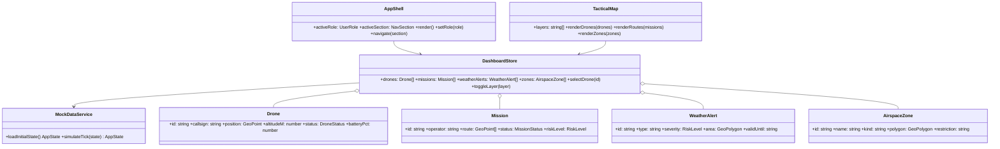
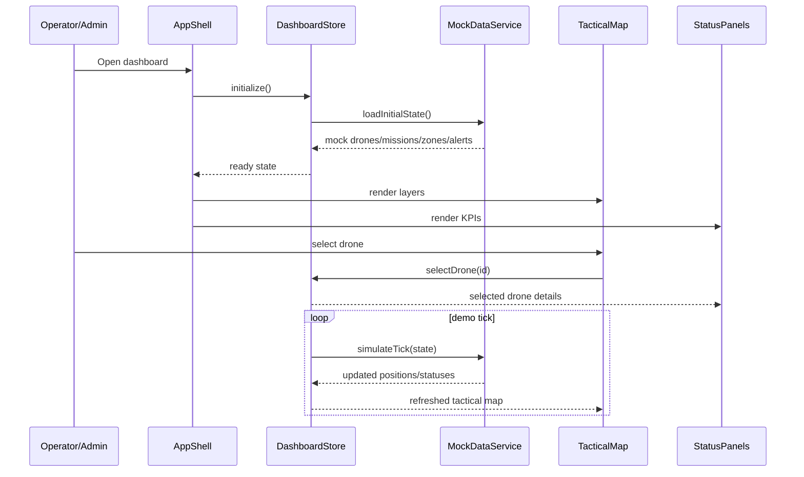
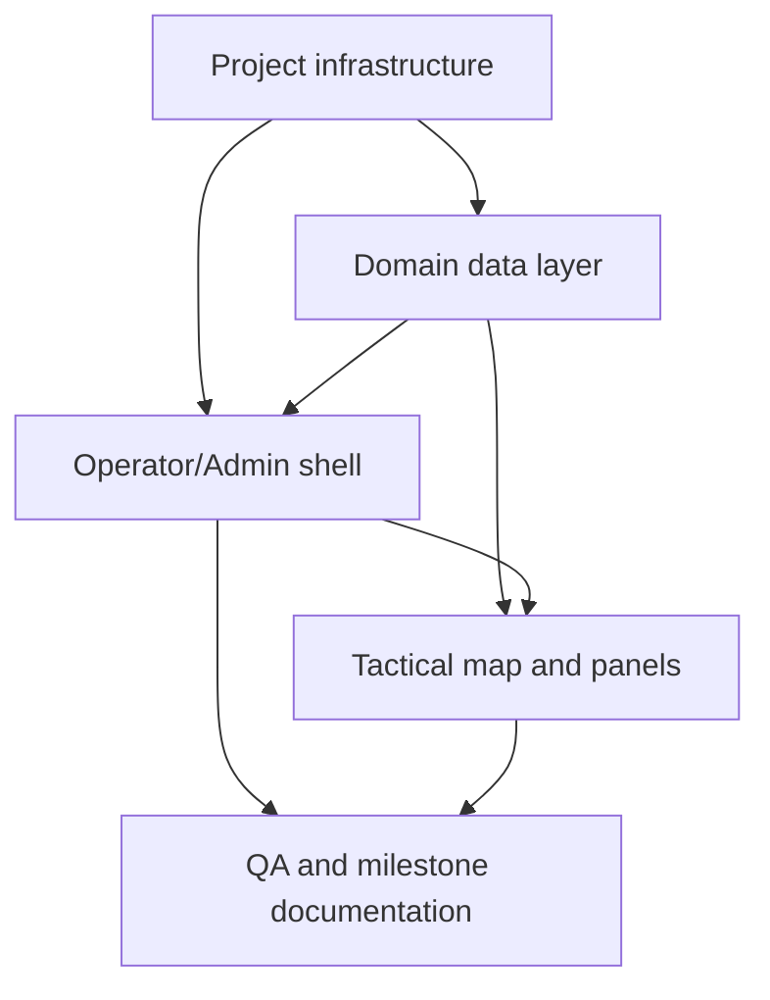

# BUSTARON v3 System Design and Milestone Plan

## Ordered Major Milestones
1. **M1 Frontend tactical shell**: Vite/React/TS mock-only SPA with dark 2D Hong Kong operations dashboard, Operator/Admin navigation, responsive/a11y foundation, and milestone doc.
2. **M2 Planning + data adapters**: mock-to-real adapter boundaries for HKO, LandsD/Open3Dhk, CAD/RFZ; route planning, A* service, credits/auction UI flows.
3. **M3 Backend, ledger, agents**: FastAPI APIs, Python LLM-agent negotiation, 3-node PoA ledger, blockchain-as-communication protocol.
4. **M4 Hardware + 3D demo**: ESP32-S3 firmware/display, CesiumJS Hong Kong 3D demo, simulated drone physics and conflict visualization.
5. **M5 Operations platform**: equipment, flight logs, maintenance, training, checklists, incidents, customer portal/API, exports, analytics.
6. **M6 BVLOS + E2E hardening**: BVLOS workflows, full E2E scripted demo, quality gates, test coverage, security/accessibility/performance review.

---

# Part A: System Design

## 1. Implementation Approach
Milestone 1 should be deliberately small and demonstrable: a frontend-only shell that proves the operational UX before backend, map APIs, blockchain, agents, or firmware exist. Core challenges are information density, role-based navigation, readable tactical geography without an external map key, and avoiding throwaway prototype structure. Use **Vite + React + TypeScript** for fast iteration, **MUI** for accessible primitives, **Tailwind CSS** for layout/tokens, **Zustand** for simple shared state, and **Vitest/Testing Library** for component tests. Architecture is **MVVM-lite/container-presentational**: mock services hydrate typed domain models, a store exposes view state, and components render composed panels. UI conventions: semantic colors, keyboard navigation, visible focus, realistic mock content, responsive breakpoints 320/768/1024/1440, no generic purple-gradient AI aesthetic.

## 2. Recommended First Milestone Scope
Build only the SPA shell: dark 2D schematic Hong Kong tactical map, mock drones/routes/zones/weather alerts, Operator/Admin navigation, status panels, layer toggles, selected-drone details, and a milestone explainer doc. No real map provider or backend.

**Acceptance criteria**
- `npm run dev`, `npm run build`, `npm run lint`, and tests run successfully.
- Landing page defaults to Operator dashboard with 2D HK tactical map.
- Admin section is reachable from navigation and shows mock compliance/system widgets.
- Map supports mock layers: drones, routes, restricted zones, weather.
- Keyboard users can navigate all controls; contrast meets WCAG AA intent.
- `docs/milestone-01.md` explains what was built, why, and how it works.

## 3. File List
```text
package.json, index.html, vite.config.ts, tsconfig.json, tsconfig.node.json
eslint.config.js, tailwind.config.ts, postcss.config.js
src/main.tsx, src/App.tsx, src/styles/globals.css
src/types/domain.ts, src/data/mockData.ts, src/services/mockDataService.ts
src/store/dashboardStore.ts
src/components/layout/AppShell.tsx, src/components/layout/SidebarNav.tsx, src/components/layout/TopBar.tsx
src/components/map/TacticalMap.tsx, src/components/map/MapLayerControls.tsx, src/components/map/DroneMarker.tsx
src/components/panels/StatusPanel.tsx, src/components/panels/MissionPanel.tsx, src/components/panels/AdminPanel.tsx
src/components/common/MetricCard.tsx, src/components/common/EmptyState.tsx
src/test/App.test.tsx, src/test/setup.ts
docs/system_design.md, docs/class-diagram.mermaid, docs/sequence-diagram.mermaid, docs/milestone-01.md
```

## 4. Data Structures and Interfaces


## 5. Program Call Flow


## 6. Anything UNCLEAR
Assumptions: exact visual branding is unavailable; use dark aviation/tactical tokens. Hong Kong map in M1 is schematic SVG/CSS, not authoritative geospatial data. “Code-reviewer conventions” means self-review checklist, edge-case notes, lint/test/build evidence, and no rubber-stamp verification.

---

# Part B: Task Decomposition

## 7. Required Packages
- `react@^18.2.0`: UI framework
- `react-dom@^18.2.0`: DOM rendering
- `typescript@^5.0.0`: static typing
- `vite@^5.0.0`: frontend build tool
- `@mui/material@^5.14.0`, `@emotion/react`, `@emotion/styled`: accessible component base
- `tailwindcss@^3.4.0`, `postcss`, `autoprefixer`: styling system
- `zustand@^4.5.0`: lightweight client state
- `lucide-react@^0.468.0`: icons
- `vitest`, `@testing-library/react`, `@testing-library/jest-dom`, `jsdom`: tests
- `eslint`, `typescript-eslint`: linting

## 8. Task List
| ID | Task Name | Source Files | Dependencies | Priority |
|---|---|---|---|---|
| T01 | Project infrastructure | `package.json`, Vite/TS/Tailwind/ESLint configs, `index.html`, `src/main.tsx`, `src/App.tsx`, `src/styles/globals.css` | None | P0 |
| T02 | Domain data layer | `src/types/domain.ts`, `src/data/mockData.ts`, `src/services/mockDataService.ts`, `src/store/dashboardStore.ts` | T01 | P0 |
| T03 | Operator/Admin shell | `AppShell.tsx`, `SidebarNav.tsx`, `TopBar.tsx`, `MetricCard.tsx`, `EmptyState.tsx` | T01,T02 | P0 |
| T04 | Tactical map and panels | `TacticalMap.tsx`, `MapLayerControls.tsx`, `DroneMarker.tsx`, `StatusPanel.tsx`, `MissionPanel.tsx`, `AdminPanel.tsx` | T02,T03 | P0 |
| T05 | QA and milestone documentation | `src/test/App.test.tsx`, `src/test/setup.ts`, `docs/milestone-01.md`, update `docs/system_design.md` if implementation diverges | T03,T04 | P1 |

## 9. Shared Knowledge
- M1 is mock-only; all data must be replaceable by future API adapters.
- Use ISO 8601 UTC strings for dates, WGS84-like `{lat,lng}` for positions.
- Keep components focused; split before 200 lines where practical.
- Every milestone ends with its own doc and then stops for user review.
- Later backend APIs should use `{code, data, message}`.

## 10. Task Dependency Graph


## 11. Out of Scope for Milestone 1
Real Mapbox/Leaflet/Cesium integration, HKO/LandsD/CAD live ingestion, A* planning, credit auctions, FastAPI, PoA blockchain, LLM negotiation, ESP32 firmware, customer portal, exports, analytics, BVLOS workflows, authentication, persistence, and production deployment.
